# Defect RCA RAG — Architecture

**Repo:** `defect-rca-rag` · **Version:** 1.0.0 · **Source of truth:** the code under `src/`, `scripts/` and `setup.sh` as of the initial commit (`a8fb22b`) plus local uncommitted changes.

---

## 1. Purpose and scope

The service takes a vendor defect number and answers one question: *which test case covers this defect?* It answers in three ways, in order of preference:

1. A test case is **already mapped** to the defect in vendor.
2. A test case is **semantically similar** to the defect (vector search over test cases seeded from vendor).
3. **No suitable test case exists**, so a local LLM writes one.

A second operation commits the choice. It creates the test case in vendor if needed, creates the defect ↔ test case mapping, opens a draft RCA record and links that RCA to the defect.

Out of scope: user authentication, a UI, LLM-written RCA content (the RCA is a templated draft), and automated tests.

---

## 2. System context

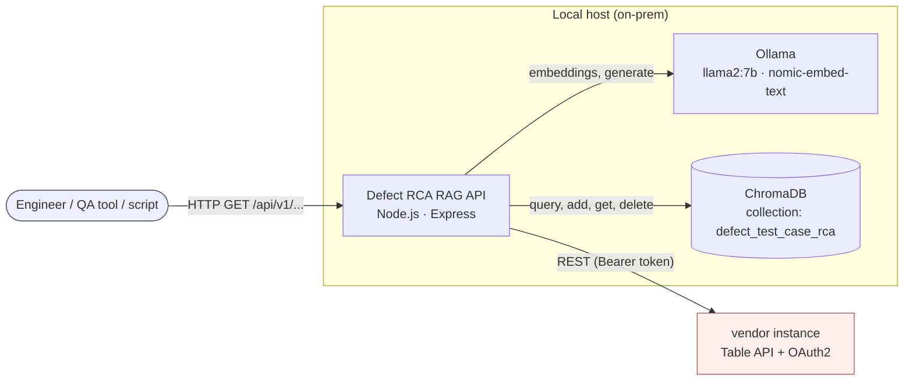

| External system | Direction | Protocol | Purpose |
|---|---|---|---|
| vendor | read/write | HTTPS REST, OAuth2 client-credentials | Defects, test cases, mappings, RCAs |
| Ollama | read | HTTP (`ollama` npm client) | Embeddings and text generation |
| ChromaDB | read/write | HTTP (`chromadb` npm client) | Test case vector store |

vendor is the only dependency outside the local host. No defect or test case text is sent to a cloud LLM.

---

## 3. Tech stack

| Layer | Technology | Version (package.json) | Notes |
|---|---|---|---|
| Runtime | Node.js | `>=16` | CommonJS modules |
| Web framework | Express | `^4.18.2` | Single process, single router |
| Security middleware | helmet, cors, express-rate-limit | `^7.0.0`, `^2.8.5`, `^6.10.0` | |
| Compression | compression | `^1.7.4` | |
| HTTP client | axios | `^1.5.0` | Two instances: OAuth and API |
| Vector DB client | chromadb | `^1.10.5` | Talks to a separate Python ChromaDB server |
| LLM client | ollama | `^0.5.16` | |
| Logging | winston, winston-daily-rotate-file | `^3.10.0`, `^4.7.1` | |
| Config | dotenv | `^16.3.1` | `.env` in repo root |
| IDs | uuid | `^9.0.0` | Fallback vector IDs |
| Declared, not used in `src/` | joi, csv-parser, csv-writer | | `joi` is imported by the controller but never called |
| Dev | nodemon, jest, supertest | | No test files exist |
| Vector DB server | ChromaDB (Python, `pip install chromadb`) | unpinned | Run via `chroma run --port 8000` |
| LLM server | Ollama | unpinned | Models: `llama2:7b`, `nomic-embed-text` |
| Provisioning | `setup.sh` (bash, macOS/Homebrew) | | setup / start / stop / status |

---

## 4. Component architecture

### 4.1 Component diagram

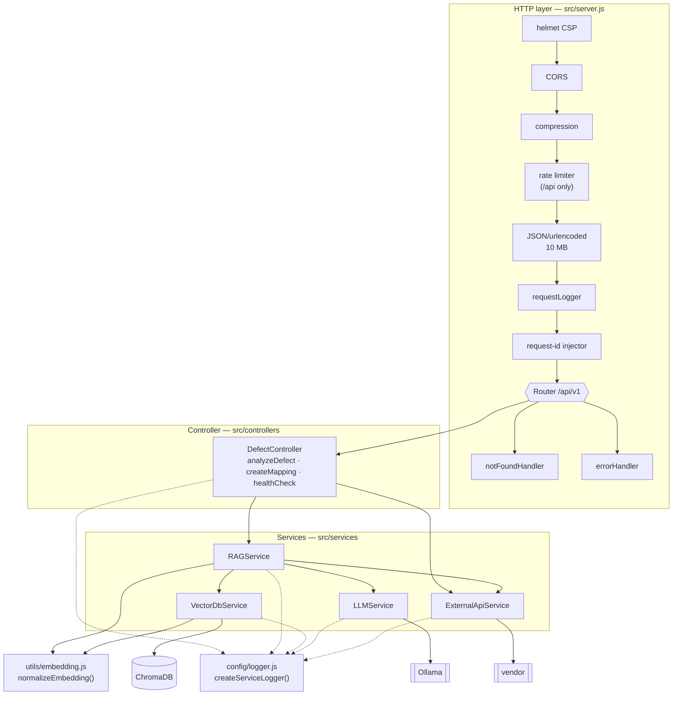

> `DefectController` and `RAGService` each create their **own** `ExternalApiService`, so there are two OAuth token caches per process. Each one fetches its own token.

### 4.2 Component responsibilities

| Component | File | Key methods | Depends on |
|---|---|---|---|
| **DefectAutomationServer** | `src/server.js` | `setupMiddleware`, `setupRoutes`, `setupErrorHandling`, `start`, `shutdown` | Express, DefectController |
| **DefectController** | `src/controllers/defectController.js` | `analyzeDefect`, `createMapping`, `healthCheck`, `initialize` (lazy, idempotent) | RAGService, ExternalApiService |
| **RAGService** | `src/services/ragService.js` | `findSimilarTestCases`, `generateTestCaseForDefect`, `createDefectTestCaseMapping`, `generateAndCreateRCA`, `storeTestCase`, `getTestCaseById`, `updateTestCaseId`; private: `_createDefectSearchText`, `_createTestCaseSearchText`, `_enhanceTestCaseResults`, `_parseHtmlSteps`, `_convertStepsToTableUI`, `_calculateConfidence`, `_generateRecommendation` | VectorDb, LLM, ExternalApi |
| **VectorDbService** | `src/services/vectorDbService.js` | `initialize`, `addTestCase`, `addTestCasesBatch`, `searchSimilarTestCases`, `getTestCaseById`, `updateTestCaseId`, `deleteTestCase`, `deleteCollection`, `listCollections`, `getCollectionStats` | chromadb client |
| **LLMService** | `src/services/llmService.js` | `generateEmbedding`, `generateTestCase`, `analyzeSimilarity`, `checkModelAvailability` | ollama client |
| **ExternalApiService** | `src/services/externalApiService.js` | `getDefectDetails`, `getDefectTestCaseMappings`, `getTestCaseDetails`, `getTestCaseListDetails`, `searchTestCases`, `createTestCase`, `createDefectTestCaseMapping`, `createRCA`, `updateDefectWithRCAs`, `healthCheck`; private `_getOAuthToken`, `_makeAuthenticatedRequest` | axios |
| **requestLogger** | `src/middleware/requestLogger.js` | Logs request/response at `http` level, sets `req.requestId` | logger |
| **errorHandler / notFoundHandler** | `src/middleware/errorHandler.js` | Maps `err.name` to a status code, hides the stack in production | logger |
| **logger** | `src/config/logger.js` | `logger`, `createServiceLogger(name)` | winston |
| **schemas** | `src/models/schemas.js` | Field descriptions for defect, test case, RCA, mapping and embedding metadata | Not imported anywhere (documentation only) |

### 4.3 Middleware pipeline (order matters)

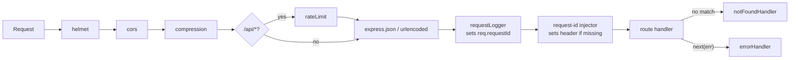

> **Correlation-ID mismatch:** `requestLogger` runs *before* the injector. When the client sends no `x-request-id`, the logger generates one ID (`req.requestId`) and the injector generates a second one (the header). The controller reads the header, so the `http` request logs and the controller logs carry different IDs.

---

## 5. Runtime flows

### 5.1 Analyze defect — decision flow

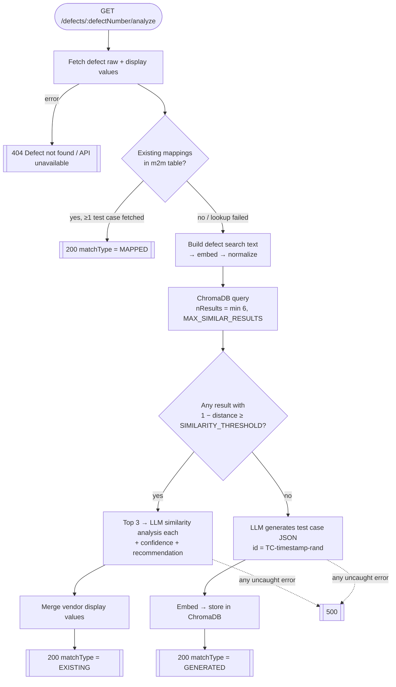

### 5.2 Analyze defect — sequence

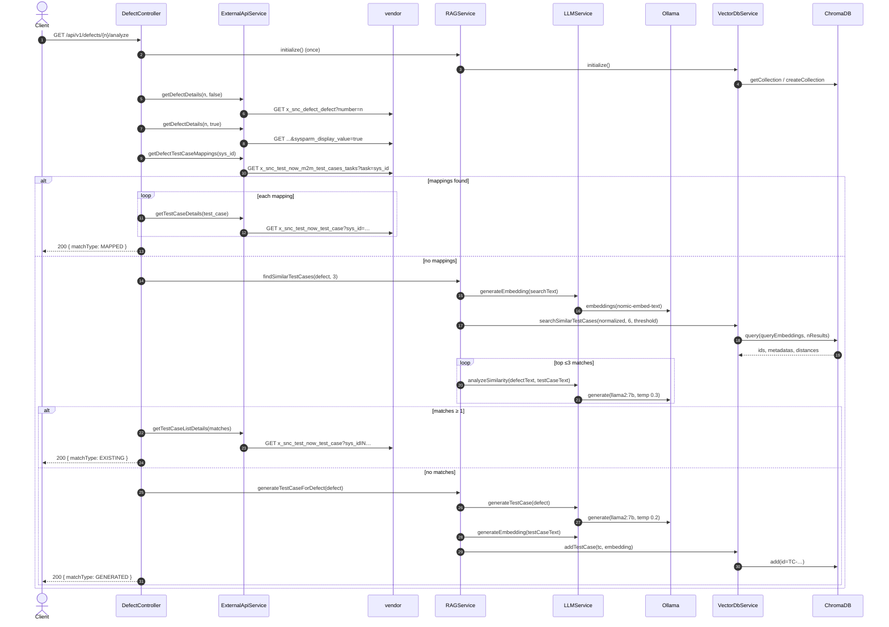

**Latency profile:** the slow part is the LLM work. An `EXISTING` result makes **1 embedding call and up to 3 sequential generate calls**. A `GENERATED` result makes **1 generate call and 2 embedding calls** (defect plus generated test case). vendor is called 3–4 times per request, and the two defect fetches run one after the other.

### 5.3 Create mapping + RCA — sequence

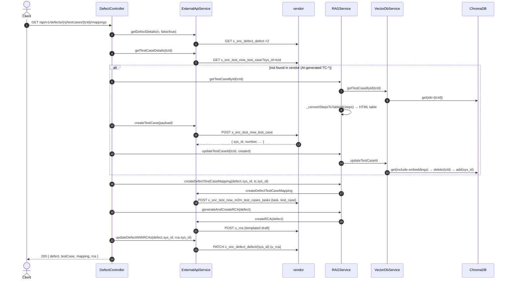

**Transactionality:** none. The writes happen one after another with no compensation. If the RCA creation fails, the test case and mapping already exist. Calling the endpoint again creates a **duplicate** mapping and a duplicate RCA. There is no idempotency check.

### 5.4 Test case ID lifecycle (vector store)

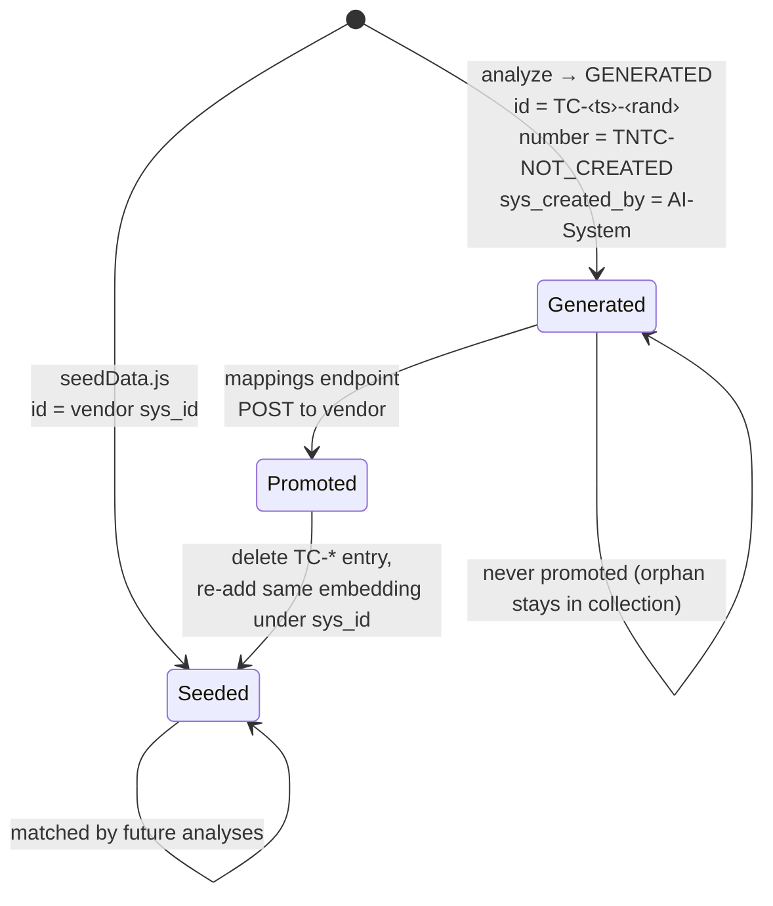

AI-generated entries stay searchable while they are still in the `Generated` state. A later defect can match an unpromoted `TC-*` entry. `getTestCaseListDetails` skips the vendor lookup for these entries because it filters out `sys_created_by == 'AI-System'`.

### 5.5 Seeding flow

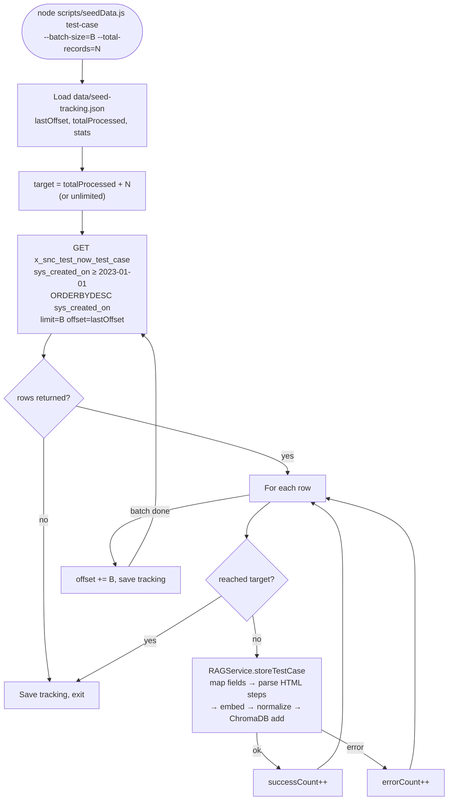

> Because the ordering is newest-first, records created between runs move the offsets, so a resumed run can skip or duplicate rows. ChromaDB `add` with an ID that already exists is rejected, and the seeder counts that as an error.

### 5.6 OAuth token management

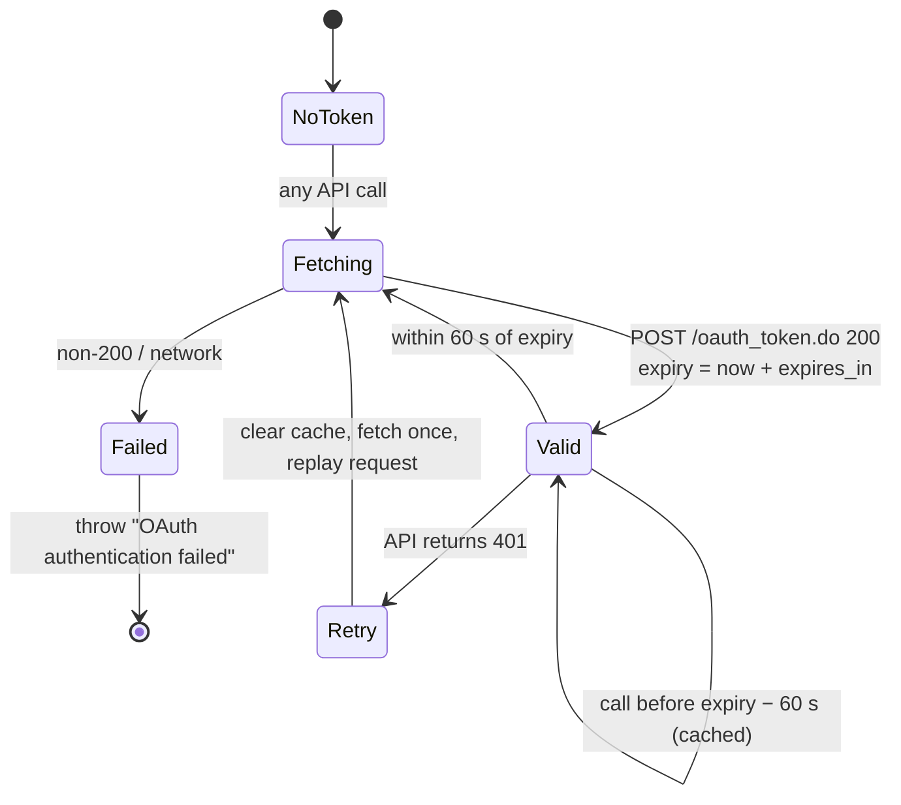

---

## 6. API contracts

**Base path:** `/api/v1` (rate-limited). **Content type:** `application/json`. **Auth:** none on this service.

**Common headers**

| Header | Direction | Notes |
|---|---|---|
| `x-request-id` | request (optional) | Echoed back as `requestId` in the defect endpoints |
| `RateLimit-*` | response | Standard headers from `express-rate-limit` (`standardHeaders: true`) |

### 6.1 Endpoint summary

| Method | Path | Handler | Side effects |
|---|---|---|---|
| GET | `/` | inline | none — returns a service descriptor (it lists a stale `POST .../mappings` route) |
| GET | `/health` | inline | none |
| GET | `/api/v1/health` | `healthCheck` | OAuth token fetch, one vendor read, ChromaDB count |
| GET | `/api/v1/defects/:defectNumber/analyze` | `analyzeDefect` | May **write to ChromaDB** (`GENERATED`) |
| GET | `/api/v1/defects/:defectNumber/testcases/:testCaseId/mappings` | `createMapping` | **Writes to vendor** (up to 4 records) and ChromaDB |

### 6.2 `GET /health`

```json
200 { "status": "healthy", "timestamp": "ISO-8601", "version": "1.0.0", "environment": "development" }
```

### 6.3 `GET /api/v1/health`

```json
200 {
  "status": "healthy",
  "timestamp": "ISO-8601",
  "services": {
    "externalApi": { "status": "up|down", "oauth": "authenticated|failed", "api": "accessible|down", "timestamp": "…", "error": "only when down" },
    "vectorDb": "up|down",
    "vectorDbStats": { "name": "defect_test_case_rca", "count": 1234 } | null
  }
}
503 { "status": "unhealthy", "error": "…", "timestamp": "…" }
```

The top-level `status` is `"healthy"` even when a downstream service is `down`. The `503` is returned only if the handler itself throws.

### 6.4 `GET /api/v1/defects/:defectNumber/analyze`

| Param | In | Type | Example |
|---|---|---|---|
| `defectNumber` | path | string (vendor `number`) | `DEF0001234` |

**Response 200 — common envelope**

```ts
{
  success: true,
  defect: DefectDisplayRecord,        // vendor row, sysparm_display_value=true
  matchType: "MAPPED" | "EXISTING" | "GENERATED",
  testCases: TestCaseResult[],
  processingTime: number,             // ms
  requestId: string
}
```

**`testCases[]` by `matchType`**

```ts
// MAPPED — vendor test case row (display values) + mapping id
{ ...vendorTestCaseRow, mappingSysId: string }

// EXISTING — vendor row merged with similarity analysis
{
  ...vendorTestCaseRow /* or vector metadata if lookup skipped/failed */,
  similarityAnalysis: {
    similarity_score: number,         // vector similarity (1 − distance), overwrites LLM score
    reasoning?: string,               // from LLM
    confidence: "high" | "medium" | "low",
    recommendation?: string
  }
}

// GENERATED — exactly one element, nested shape
{
  testCase: {
    id: "TC-<ms>-<5 chars>",
    number: "TNTC-NOT_CREATED",
    short_description: "<defect number> - <defect short_description>",
    prerequisites: string,
    product_service: string,          // defect.u_product_service.value (sys_id)
    product_category: string,         // defect.u_product_category.value
    peer_approval_status: "not requested",
    steps: { step: string, expected_result: string }[],
    assignment_group: string,
    supported_releases: string,       // defect.u_target_version.value
    facet: string,                    // defect.defect_type
    priority: string,
    sys_tags: string[],               // + "ai-generated", "defect-<number>"
    sys_created_by: "AI-System",
    sys_created_on: string,
    genai_generated: "true",
    automation_status: "candidate"
  },
  similarity: 1.0,
  confidence: "high",
  isGenerated: true
}
```

> The `GENERATED` shape nests the test case under `testCase`. `MAPPED` and `EXISTING` return flat records. Clients need to branch on `matchType`. To promote a generated case, pass `testCases[0].testCase.id` as `:testCaseId` to the mappings endpoint.

**Confidence and recommendation rules** (`RAGService`)

| Condition | `confidence` |
|---|---|
| vector > 0.85 **and** LLM score > 0.80 | `high` |
| vector > 0.70 **and** LLM score > 0.60 | `medium` |
| otherwise | `low` |
| LLM analysis threw (fallback) | > 0.8 high, > 0.6 medium, else low (vector only) |

| Vector similarity | `recommendation` |
|---|---|
| > 0.85 | "Highly recommended - Strong similarity detected" |
| > 0.70 | "Recommended - Good similarity with some differences" |
| otherwise | "Consider with caution - Low similarity score" |

If the LLM output can't be parsed, `analyzeSimilarity` falls back to `similarity_score: 0.5`.

**Errors**

| Status | When | Body |
|---|---|---|
| 404 | Defect fetch failed (not found **or** vendor/OAuth down) | `{ success:false, error:"Defect not found or external API unavailable", message, requestId }` |
| 429 | Rate limit exceeded | `{ success:false, error:"Too many requests", message }` |
| 500 | Anything else (embedding, Chroma, LLM parse) | `{ success:false, error:"Internal server error during defect analysis", message, requestId, processingTime }` |

### 6.5 `GET /api/v1/defects/:defectNumber/testcases/:testCaseId/mappings`

| Param | In | Type | Notes |
|---|---|---|---|
| `defectNumber` | path | string | vendor defect `number` |
| `testCaseId` | path | string | vendor test case `sys_id` **or** a `TC-*` ID from a `GENERATED` analysis |

**Response 200**

```ts
{
  success: true,
  defect: DefectDisplayRecord,
  testCase: vendorTestCaseRow,     // existing or newly created
  mapping:  { sys_id, task, test_case, ... },   // created m2m row
  rca:      { sys_id, u_number, ... },          // created u_rca row
  processingTime: number,
  requestId: string
}
```

**Errors**

| Status | When |
|---|---|
| 404 | Defect fetch failed |
| 500 | Test case creation failed (`"Failed to create test case in external system"`), including when `testCaseId` matches nothing in either store |
| 500 | Mapping, RCA or defect-update failure (`"Internal server error during mapping creation"`). Earlier writes are **not** rolled back |

### 6.6 Outbound vendor contracts

All calls go to `${EXTERNAL_API_BASE_URL}` with `Authorization: Bearer <token>`, `Accept: application/json`, `User-Agent: DefectAutomationSystem/1.0`.

| Operation | Method & path | Query / body |
|---|---|---|
| Token | `POST /oauth_token.do` (form-encoded) | `grant_type`, `client_id`, `client_secret` |
| Get defect | `GET /api/now/table/x_snc_defect_defect` | `sysparm_query=number=<n>`, `sysparm_display_value=true\|false` |
| Get mappings | `GET /api/now/table/x_snc_test_now_m2m_test_cases_tasks` | `sysparm_query=task=<defect sys_id>`, `sysparm_limit=10` |
| Get test case | `GET /api/now/table/x_snc_test_now_test_case` | `sysparm_query=sys_id=<id>`, `sysparm_display_value=true` |
| Get test case list | `GET /api/now/table/x_snc_test_now_test_case` | `sysparm_query=sys_idIN<ids>`, `sysparm_limit=10` |
| Search test cases (seed) | `GET /api/now/table/x_snc_test_now_test_case` | `sysparm_query=sys_created_on>=…^ORDERBYDESCsys_created_on`, `sysparm_limit`, `sysparm_offset` |
| Create test case | `POST /api/now/table/x_snc_test_now_test_case` | Vector-store test case with `steps` rendered as an HTML table |
| Create mapping | `POST /api/now/table/x_snc_test_now_m2m_test_cases_tasks` | `{ task: <defect sys_id>, test_case: <tc sys_id> }` |
| Create RCA | `POST /api/now/table/u_rca` | see below |
| Link RCA | `PATCH /api/now/table/x_snc_defect_defect/<sys_id>` | `{ u_rca: <rca sys_id> }` |

**RCA payload** (`_prepareRCAPayload`) — values are hard-coded unless noted:

```json
{
  "u_defect": "<defect.sys_id>",
  "defect_short_description": "<defect.short_description>",
  "release": "<defect.u_target_version.value>",
  "u_product_service": "<defect.u_product_service.value>",
  "u_product_category": "<defect.u_product_category.value>",
  "u_assignment_group": "<defect.assignment_group.value>",
  "u_state": "Draft",
  "u_rca_type": "Release Candidates",
  "u_how_was_the_issue_introduced": "Should automate this",
  "how_was_the_issue_found": "Manual",
  "u_how_to_prevent_detect_the_issue": "no"
}
```

### 6.7 Outbound Ollama contracts

| Call | Model | Options | Output handling |
|---|---|---|---|
| `embeddings({ model, prompt })` | `EMBEDDING_MODEL` | — | `response.embedding` (float[]) |
| `generate` — test case | `OLLAMA_MODEL` | `temperature 0.2`, `top_p 0.6`, `max_tokens 2000`, `stream:false` | First `{…}` block parsed as JSON: `{prerequisites, steps[{step, expected_result}], category, component, priority, sys_tags[]}` |
| `generate` — similarity | `OLLAMA_MODEL` | `temperature 0.3`, `top_p 0.7` | First `{…}` block parsed as JSON: `{similarity_score, reasoning}`; falls back to 0.5 |

> `max_tokens` isn't an Ollama option name (Ollama uses `num_predict`), so it is probably ignored. `OLLAMA_TIMEOUT` is read into `this.timeout` but never passed to the client.

---

## 7. Data architecture

### 7.1 Entity relationships (vendor side)

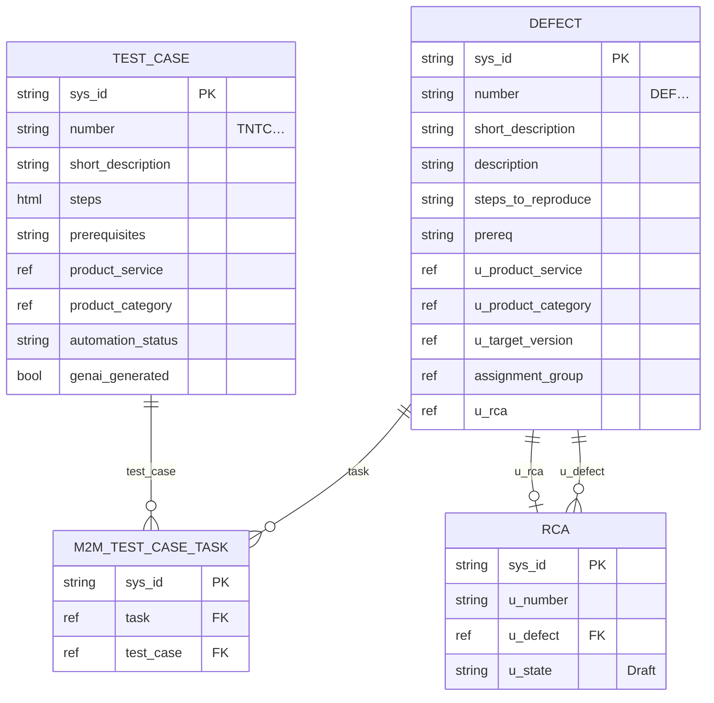

### 7.2 Vector store schema (ChromaDB)

| Element | Content |
|---|---|
| Collection | `CHROMA_COLLECTION_NAME` (default `defect_test_case_rca`). Created on first start with metadata `{description, created_at}` |
| ID | vendor `sys_id` (seeded or promoted) or `TC-*` (generated) |
| Embedding | `nomic-embed-text` vector, **L2-normalized** before storage |
| Document | `Title / Component / Category / Problem Type / Prerequisites / Steps to reproduce`, one per line |
| Metadata | `id, number, title, category, component, priority, prerequisites, assignment_group, facet, steps (JSON string), sys_created_on, sys_created_by, genai_generated, automation_status, sys_tags (JSON string)` |

**Embedding text symmetry:** defects and test cases go through the same template, `_createDefectSearchText` / `_createTestCaseSearchText`. That keeps both sides in the same text format, which helps retrieval. `Component` and `Category` contain reference **sys_ids**, not names. They act as exact-match tokens and carry no meaning for the embedding model.

**Similarity math:** similarity is computed as `1 − distance`. The collection is created with `embeddingFunction: 'cosine'`, which doesn't set the HNSW space (that's `metadata: {"hnsw:space": "cosine"}`). The collection therefore probably uses the default **squared L2**. For unit vectors, `L2² = 2 − 2·cos`, so the reported similarity is `2·cos − 1`. A threshold of 0.65 then corresponds to cos ≈ 0.825.

### 7.3 Local files

| Path | Written by | Purpose |
|---|---|---|
| `data/seed-tracking.json` | `seedData.js` | Resume state (`lastOffset`, `totalProcessed`, `stats`) |
| `data/*.json` (others) | — | Sample vendor payloads for reference. Not read by the code |
| `chroma/` | ChromaDB server | Persistent vector data (git-ignored) |
| `logs/` | winston | Rotating logs (git-ignored) |
| `.ollama.pid`, `.chroma.pid` | `setup.sh start` | Background PIDs for `setup.sh stop` |

---

## 8. Configuration

Loaded by `dotenv` from `.env` at process start. The table lists every `process.env` read in `src/` and `scripts/`.

| Variable | Default | Read by | Effect |
|---|---|---|---|
| `PORT` | `3000` | server | Listen port |
| `NODE_ENV` | `development` | server, logger, errorHandler | `production` turns off console logging and stack traces in errors |
| `ALLOWED_ORIGINS` | `*` | server | CORS allow-list (comma-separated) |
| `RATE_LIMIT_WINDOW_MS` | `900000` | server | Rate-limit window |
| `RATE_LIMIT_MAX_REQUESTS` | `100` | server | Requests per window, `/api/*` only |
| `EXTERNAL_API_BASE_URL` | — (required) | ExternalApiService | vendor instance root |
| `EXTERNAL_CLIENT_ID` | — (required) | ExternalApiService | OAuth client ID |
| `EXTERNAL_CLIENT_SECRET` | — (required) | ExternalApiService | OAuth client secret |
| `EXTERNAL_GRANT_TYPE` | — (required) | ExternalApiService | e.g. `client_credentials` |
| `EXTERNAL_API_TIMEOUT` | `30000` | ExternalApiService | axios timeout (ms) |
| `OLLAMA_BASE_URL` | `http://localhost:11434` | LLMService, test-ollama | Ollama host |
| `OLLAMA_MODEL` | `llama2:7b` | LLMService | Generation model |
| `EMBEDDING_MODEL` | `nomic-embed-text` | LLMService | Embedding model |
| `OLLAMA_TIMEOUT` | `60000` | LLMService | Read but **not applied** |
| `CHROMA_HOST` | — (required) | VectorDbService | No default; unset gives `http://undefined:undefined` |
| `CHROMA_PORT` | — (required) | VectorDbService | |
| `CHROMA_COLLECTION_NAME` | `defect_test_case_rca` | VectorDbService | |
| `CHROMA_DB_URL` | `http://localhost:8000` | check-chromadb.js only | |
| `SIMILARITY_THRESHOLD` | `0.7` | RAGService, VectorDbService | Minimum `1 − distance` |
| `MAX_SIMILAR_RESULTS` | `10` | VectorDbService | Caps the `nResults` query size |
| `BATCH_SIZE` | `100` | VectorDbService.addTestCasesBatch | Not used by the current seeder path |
| `LOG_DIR` | `./logs` | logger | |
| `LOG_LEVEL` | `info` | logger | File log level |
| `LOG_MAX_SIZE` | `20m` | logger | Per-file rotation size |
| `LOG_MAX_FILES` | `14d` | logger | Retention for error/combined logs (api log is fixed at `7d`) |

> **Config drift:** `setup.sh` writes `EXTERNAL_API_USERNAME/PASSWORD/CLIENT_ID/CLIENT_SECRET`. The code never reads these, and it reads `EXTERNAL_GRANT_TYPE`, which `setup.sh` doesn't write. A `.env` generated by `setup.sh` fails OAuth until it's fixed by hand.

**Hard-coded tunables** (not configurable via env)

| Value | Location |
|---|---|
| topK = 3, query size = topK × 2 | `defectController` → `findSimilarTestCases(…, 3)` |
| Confidence/recommendation cut-offs 0.85 / 0.70 | `ragService` |
| Token refresh buffer 60 s | `externalApiService` |
| Seed start date `2023-01-01` | `seedData.js` |
| LLM temperatures 0.2 / 0.3 | `llmService` |
| Body limit 10 MB | `server.js` |

---

## 9. Deployment topology

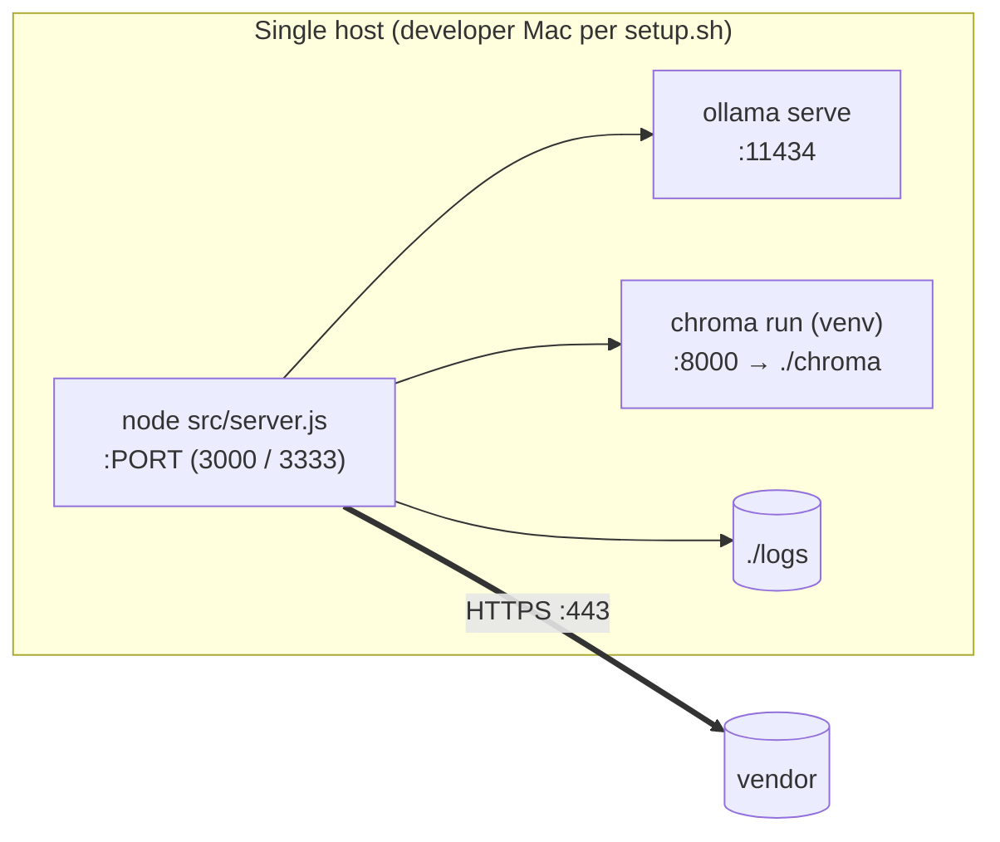

- **Process model:** a single Node process. The controller's `isInitialized` flag and the OAuth cache are in-memory per process, so horizontal scaling works but each instance keeps its own token cache.
- **Startup order:** ChromaDB must be up before `npm start`. `initialize()` runs in `start()`, and the process exits if it fails. Ollama is only needed when a request comes in.
- **Shutdown:** `SIGINT`/`SIGTERM` call `server.close()`. `uncaughtException` and `unhandledRejection` exit with code 1.
- **Resources:** `llama2:7b` needs about 4–8 GB of RAM or VRAM. The number of LLM calls per request (§5.2) drives throughput.

---

## 10. Cross-cutting concerns

### 10.1 Logging and observability

| Transport | File pattern | Level | Retention |
|---|---|---|---|
| DailyRotateFile | `logs/error-%DATE%.log` | error | `LOG_MAX_FILES` (14d), gzipped |
| DailyRotateFile | `logs/combined-%DATE%.log` | `LOG_LEVEL` | `LOG_MAX_FILES` (14d), gzipped |
| DailyRotateFile | `logs/api-%DATE%.log` | http | 7d, gzipped |
| Console | stdout | — | only when `NODE_ENV !== production` |

Every service logger is tagged with a service name via `createServiceLogger`. `requestLogger` records method, URL, status, duration and response size. There are no metrics or tracing exporters.

### 10.2 Security posture

| Control | Status |
|---|---|
| Inbound authentication / authorization | **None** |
| Transport security | Plain HTTP; terminate TLS upstream |
| CORS | `*` with `credentials: true` unless `ALLOWED_ORIGINS` is set |
| Rate limiting | `/api/*`, 100 per 15 min per IP (defaults) |
| Security headers | helmet with a restrictive CSP |
| Secrets | `.env` (git-ignored); OAuth client secret is sent in a form body over HTTPS |
| Error leakage | Stack traces hidden in production. Controller `500`s still return `error.message` |
| Unsafe verb | State-changing **GET** on `/mappings` can be triggered by prefetchers, link unfurlers or crawlers |
| Injection surface | `defectNumber` and `testCaseId` are put directly into `sysparm_query` (`number=${…}`, `sys_id=${…}`) without escaping, so a crafted value can add encoded-query clauses (`^OR…`). This is read-only, and the scope is limited by the OAuth user's ACLs |
| LLM output → vendor | Generated step text is put into HTML (`_convertStepsToTableUI`) without escaping and posted to vendor |

### 10.3 Error handling strategy

- Each controller method catches its own errors and returns structured JSON. The global `errorHandler` only catches errors passed with `next(err)`, which the current handlers never do.
- Some failures **degrade** instead of failing: mapping lookup failure falls through to vector search, LLM similarity failure falls back to vector-only confidence, and display-value fetch failure falls back to vector metadata.
- Other failures stop the request: defect fetch, embedding, ChromaDB query and test case generation.

---

## 11. Known defects and risks

| # | Area | Issue | Impact |
|---|---|---|---|
| 1 | Retrieval | `embeddingFunction: 'cosine'` doesn't set the distance space; similarity is probably `2·cos − 1` | Thresholds are stricter than intended, so more `GENERATED` results |
| 2 | Display merge | `testCases.find(tc => tc.sys_id === tc.sys_id)` shadows the outer variable | Every `EXISTING` result shows the **first** vendor record's fields |
| 3 | Mapping flow | `vectorDb.getTestCaseById` returns `null` when not found; `ragService.getTestCaseById` then reads `.steps` on it | An unknown `testCaseId` gives a `TypeError`, surfaced as a 500 |
| 4 | Mapping flow | No idempotency or compensation | Retries create duplicate mappings and RCAs; partial failures leave orphan records |
| 5 | Correlation | Logger and controller generate separate request IDs | Logs for one request are hard to join |
| 6 | Config | `setup.sh` env names don't match the code | OAuth fails out of the box |
| 7 | Config | `CHROMA_HOST/PORT` have no defaults | Startup fails with an unclear error if they're unset |
| 8 | LLM | `max_tokens` is ignored by Ollama; `OLLAMA_TIMEOUT` is unused | Long or hanging generations aren't bounded |
| 9 | Data integrity | Required fields (`u_product_service`, `u_product_category`, `assignment_group`, `u_target_version`) are dereferenced without guards | Defects missing any of them fail generation and RCA creation |
| 10 | Docs drift | `GET /` and startup logs advertise `POST /defects/{n}/mappings` | Misleads API consumers |
| 11 | Health | `/api/v1/health` reports `healthy` even when a dependency is down | Load balancers and monitors can't rely on it |
| 12 | Seeder | Newest-first ordering with offset paging | Records can be skipped or duplicated across runs |
| 13 | Two OAuth caches | Controller and RAGService each hold their own `ExternalApiService` | Two token fetches per process; harmless but wasteful |
| 14 | Tests | None | Regressions go unnoticed |

---

## 12. Glossary

| Term | Meaning |
|---|---|
| **RAG** | Retrieval-Augmented Generation. Here, vector retrieval of test cases plus LLM scoring and generation |
| **RCA** | Root Cause Analysis record (`u_rca`) |
| **m2m** | Many-to-many mapping table between tasks (defects) and test cases |
| **sys_id** | vendor 32-character record primary key |
| **TC-\*** | Temporary ID for an AI-generated test case not yet created in vendor |
| **Display value** | vendor's human-readable rendering of reference/choice fields (`sysparm_display_value=true`) |
